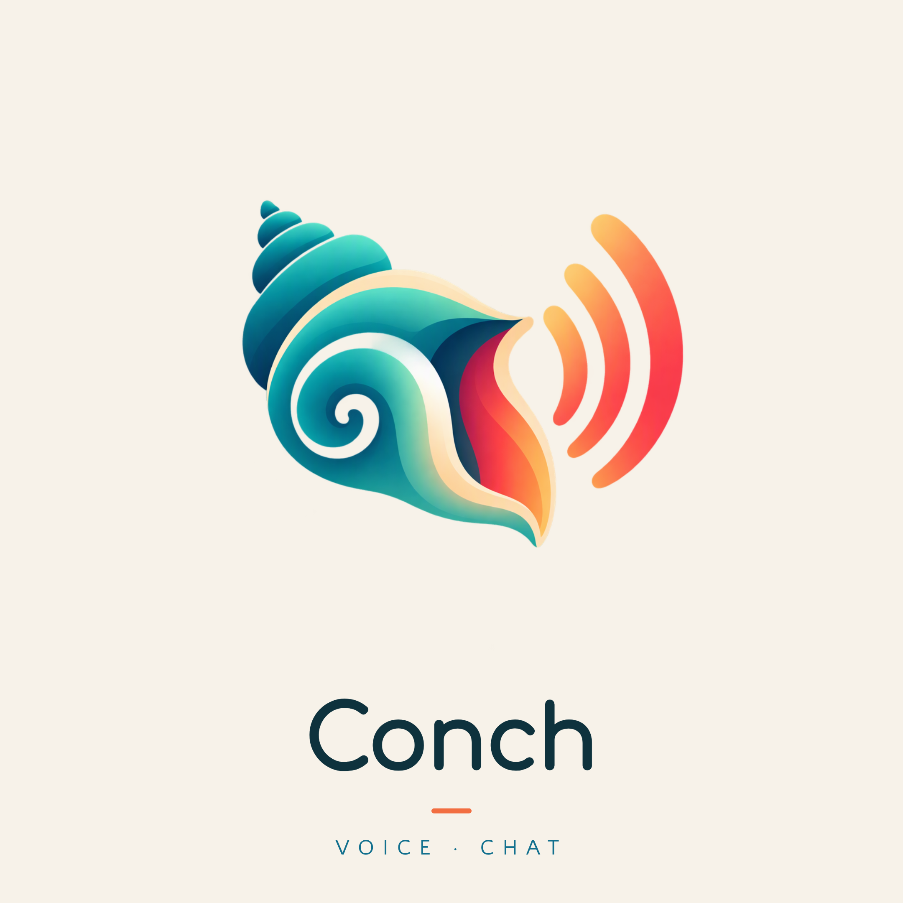
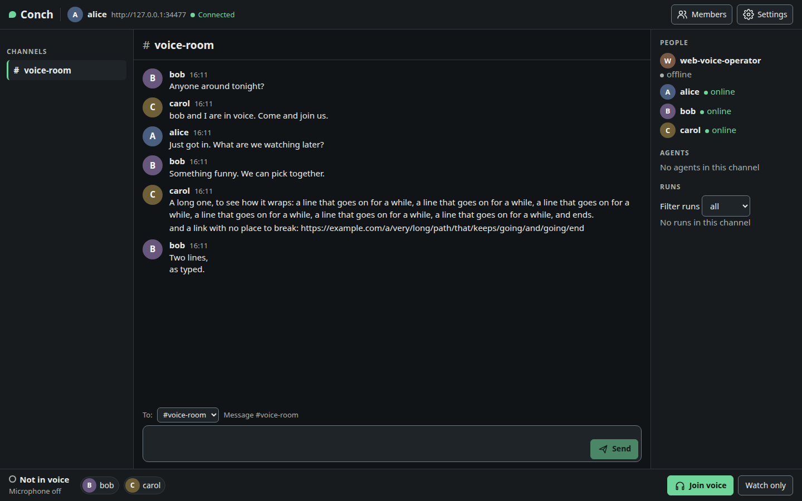

<p align="center">
  
</p>

<p align="center">
  <strong>Open-source, self-hosted communications for people and AI agents.</strong><br>
  Chat, voice, and screen sharing with explicit audiences, governed agents, and an auditable core.
</p>

<p align="center">
  <a href="https://github.com/njdaniel/conch/actions/workflows/ci.yml"></a>
</p>

<p align="center">
  <a href="#quickstart">Quickstart</a> ·
  <a href="docs/manual.md">Manual</a> ·
  <a href="docs/deploy.md">Deploy</a> ·
  <a href="ROADMAP.md">Roadmap</a> ·
  <a href="CONTRIBUTING.md">Contributing</a> ·
  <a href="SECURITY.md">Security</a>
</p>

## Communicate without losing control

Conch gives small communities and engineering teams one place to talk, coordinate, and work with AI agents. Use the browser or terminal, keep your own data, and choose exactly who can read, speak, or act.

People and agents share the same conversation log, but they are not the same kind of principal. Agents have explicit identities, scoped capabilities, visible runs, and structured approval requests. Humans remain responsible for decisions.

- **Chat with context.** Channels, threads, files, search, unread state, and typed messages across browser, TUI, CLI, REST, and WebSocket clients.
- **Keep audiences explicit.** Text nets and whispers let a lead coordinate across groups without broadcasting every message to everyone.
- **Talk and share.** Browser voice and screen sharing, plus a native Linux/PipeWire `conch-voice` client, through optional LiveKit media.
- **See what agents are doing.** Sessions, current tasks, run timelines, activity, and supported message, cancel, pause, and resume interventions.
- **Ask before acting.** Agents request approvals through MCP; people decide with a reason, and the request, decision, and outcome remain auditable.
- **Run the core yourself.** A single Go server with embedded SQLite handles messaging, identity, approvals, and audit without requiring another service.

## A client built for conversation



The browser client brings chat, people and agent presence, run views, voice, and screen sharing into one interface. The Go TUI remains a first-class client for terminal workflows and approvals.

## Current status

Conch is in a **private communications alpha**. The main flows are implemented and exercised in CI; cross-platform browser behaviour and real-device voice reliability are still being validated. Expect changes and read the deployment and security notes before inviting a group.

| Area | Available on `main` | Still being built or validated |
| --- | --- | --- |
| Messaging | Channels, threads, files, search, typed messages, nets, whispers, unread state | Richer conversation features as real usage earns them |
| Browser | Chat, invites, people and agent views, settings, diagnostics, responsive desktop/mobile UI | Wider manual browser and device validation |
| Voice and sharing | Browser push-to-talk and open microphone, watch-only mode, screen sharing with browser-supported audio | Layered voice nets, captions, and broader platform validation |
| Native voice | Standalone Rust `conch-voice` for Linux/PipeWire with native push-to-talk | Integrated TUI voice controls, packaging, and other native platforms |
| Agents | MCP messaging and approvals, sessions, runs, activity, interventions, and reference adapters | More runtime coverage and richer orchestration |
| Deployment | Single-server core, embedded web client, invites, audit, diagnostics, and deployment runbooks | More production and upgrade evidence from the alpha |

The [roadmap](ROADMAP.md) separates shipped work, the current alpha, and later direction. Captions, translation, an Electron desktop shell, and integrated TUI voice are not claimed as current features.

## Quickstart

### Try the full local demo

The demo starts `conchd`, the browser client, and LiveKit, then creates an operator and a channel. It needs [Go 1.25](https://go.dev), Docker, and the Node version in [`web/.nvmrc`](web/.nvmrc) for the first browser build; run `scripts/dev-stack.sh --help` for the other host tools and configuration options.

```sh
git clone https://github.com/njdaniel/conch.git
cd conch
scripts/dev-stack.sh up
scripts/dev-stack.sh token
```

Open **http://127.0.0.1:28080/app/** and paste the credential printed by `token`. Keep that credential private. To invite a second person for a two-hour local demo:

```sh
scripts/dev-stack.sh invite
```

The demo state lives in `~/.cache/conch-dev`, outside the checkout. When you are finished:

```sh
scripts/dev-stack.sh down          # stop the demo
scripts/dev-stack.sh down --wipe   # stop it and delete its local state
```

### Build only the core

Go is enough to build the server, CLI/TUI, and adapters; Node, Rust, Docker, and LiveKit are not required for text messaging and approvals.

```sh
make build
```

This produces `bin/conchd`, `bin/conch`, `bin/conch-adapter`, and `bin/conch-bot`. Continue with [bootstrap and first sign-in](docs/manual.md#2-create-the-operator-and-start-conchd) in the full manual.

## Architecture at a glance

```text
Browser ─────────┐
conch TUI / CLI ─┤
conch-voice ─────┼── REST / WebSockets / MCP ── conchd ── embedded SQLite
Agents and MCP ──┘                                  │
                                                    └── optional LiveKit
                                                        voice + screen media
```

- **`conchd` is the core.** It owns identity, membership, messages, scoped delivery, sessions, runs, approvals, and audit. Messaging and approvals keep working when LiveKit is absent or unavailable.
- **Clients use public contracts.** Browser and terminal clients use REST and WebSockets; agents use MCP and the same server-enforced permissions. Wire shapes come from `pkg/schema`.
- **Media is optional.** LiveKit transports audio and screen tracks. It is a separate integration, not a dependency of the dependency-free messaging core.
- **One server, one community.** Hosted multi-tenancy, federation, and bespoke WebRTC are outside the current design.

Read [ADR-001](docs/adr/ADR-001-mcp-native-architecture.md), [ADR-002](docs/adr/ADR-002-single-binary-sqlite.md), and the other [architecture decisions](docs/adr/) for the boundaries.

## Documentation

| Document | What it covers |
| --- | --- |
| [Full manual](docs/manual.md) | Step-by-step setup, CLI/TUI, MCP, adapters, nets, invites, TLS, voice, screen sharing, and diagnostics |
| [Deployment runbook](docs/deploy.md) | A versioned public server with Caddy, LiveKit, systemd, backups, restore, upgrade, and rollback |
| [Alpha tester guide](docs/alpha-tester-guide.md) | Joining and using Conch as an invited tester |
| [Contributing](CONTRIBUTING.md) | Toolchains, checks, issue and PR workflow, and review rules |
| [Roadmap](ROADMAP.md) | Shipped phases, the private alpha, and later product direction |
| [Client experience](docs/design/client-experience.md) | Interaction and client design, including voice and failure states |
| [ADRs](docs/adr/) | Accepted architecture and product constraints |

## Development

```sh
make build                  # Go binaries
make check                  # required formatting, lint, tests, schema, dependency, Rust, and web gates
go run ./e2e/dogfood        # live request → notify → resolve → audit approval loop
```

`make check` uses pinned tool versions and includes the Rust and browser legs; it does not silently skip a missing toolchain. See [Contributing](CONTRIBUTING.md) for setup and the end-to-end checks that apply to each area.

## Trust and security

Conch uses a **server-trust model, not end-to-end encryption**. The operator controls the server and database. Nets and whispers enforce server-side delivery to their intended audience; they cannot prevent a recipient from repeating what they received.

Agent manifests restrict what an agent may do in Conch, but they do not sandbox the agent's external tools. Audit records make activity inspectable; they are not a cryptographic guarantee against an operator modifying the database.

Report security vulnerabilities privately through [GitHub's security advisories](SECURITY.md), not in a public issue. For bugs and product feedback, use the [issue forms](https://github.com/njdaniel/conch/issues/new/choose).

## Why “Conch”?

A conch is a signal horn and a symbol of speaking rights. The name reflects the goal: help people and agents know when to speak, whom they are addressing, and who can hear.

## License

Conch is available under [AGPL-3.0](LICENSE).
