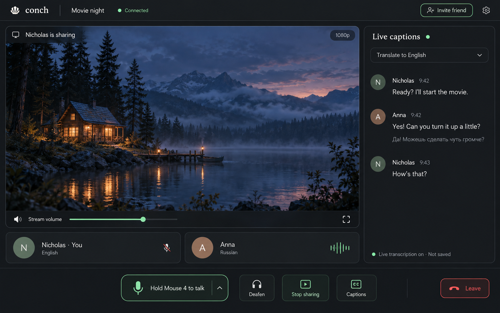
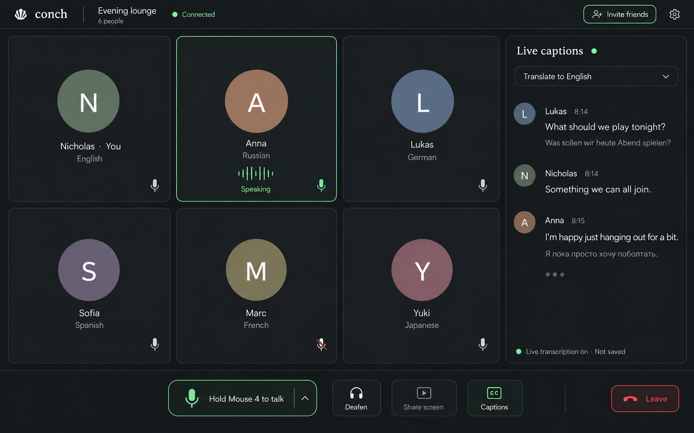
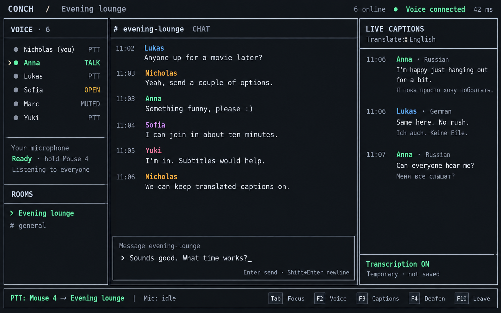
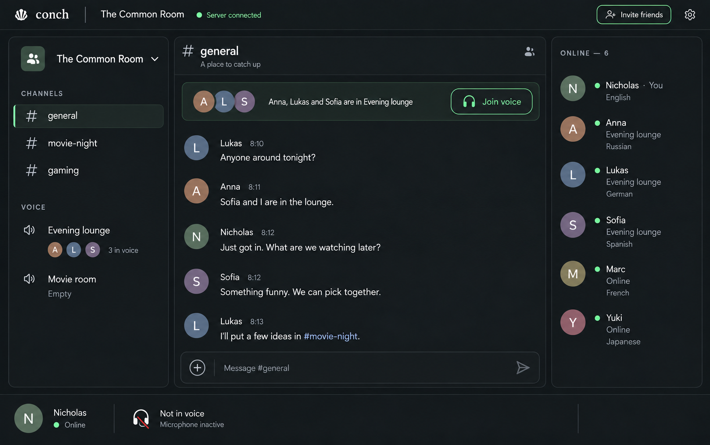
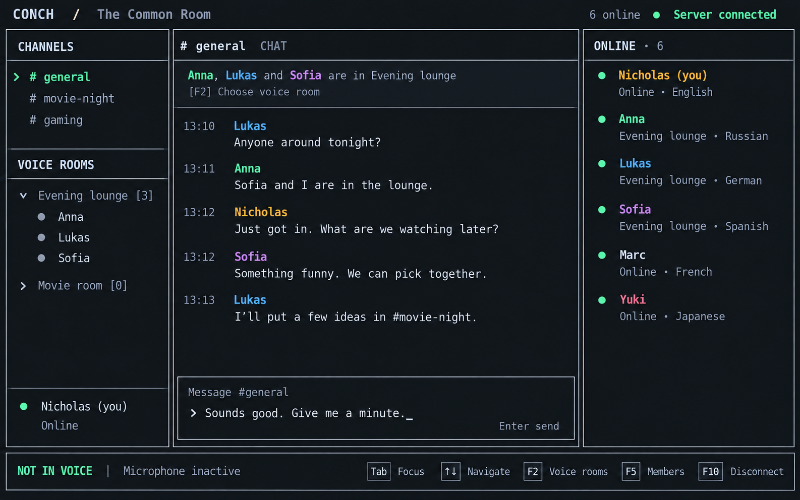

# Conch interface references

Original generated concept images from Nicholas's “AI Build Time Cost Estimate”
conversation and the follow-up client-design conversation on 2026-10-13.
Collected for implementation reference.

Behavior is specified in [client experience](../client-experience.md); scope and
stack are in [proposed ADR-007](../../adr/ADR-007-client-interfaces.md).
The [P3 planning brief](../p3-local-prototype.md) selects the initial prototype subset.
These are visual targets, not screenshots of working features. Accepted ADRs and
the project roadmap remain authoritative for architecture and delivery scope.

## Movie night

Large shared-screen area, compact participant strip, separate stream volume,
translated captions beside the content, and persistent push-to-talk controls.

## Voice lounge

Participant grid when nobody shares a screen. Keep speaker activity, language,
microphone status, and caption controls easy to scan.

## Terminal chat

Roster and room navigation on the left, text conversation in the center, optional
live captions on the right, and a persistent input/status area. Preserve this
information hierarchy when adapting the layout to smaller terminals.

## Graphical server lobby

Channels and voice presence on the left, chat in the center, online members on the
right. The bottom strip says Not in voice / Microphone inactive. Joining voice is
explicit and independent of text selection (UX-01 through UX-05).

## TUI server lobby

The same outside-voice state in terminal panels, with visible focus, a composer,
member roster and keyboard hints (UX-04, UX-08, UX-21). Shortcut labels are
illustrative and need terminal/browser collision checks before implementation.

## Implementation guidance

- Keep the current listening set, microphone state, PTT binding, and transmit
  destination visible. Browsing another text conversation must not silently
  redirect transmission.
- Captions identify the speaker, source language, and source net where applicable.
  Translation is optional; preserve access to the original text.
- Treat “temporary / not saved” as a proposed retention behavior that needs actual
  enforcement and processing disclosure, not a promise established by these images.
- Generated text, icons, translations, and keyboard hints are illustrative. Correct
  them during implementation. The TUI image's “OPEN” badge does not establish an
  open-microphone policy or override push-to-talk requirements.
- Screen sharing, voice, captioning, and text chat need independent, explicit
  controls and honest availability states.

## Follow-up states discussed

The following states need dedicated mockups; no corresponding image is included
in this set.

| State | Proposed behavior to develop |
| --- | --- |
| Multiple nets | Show overlapping memberships, listening versus speaking permissions, activity per net, and explicit PTT targets. A net remains a subset of a channel, consistent with ADR-005. |
| TUI multiple nets | Adapt listening membership, role and transmit-target visibility to terminal panels. |
| One-to-one multilingual conversation | Show original/translated text and language controls; does not itself advance human DMs ahead of the roadmap. |

Implement these references through the existing public APIs and project review
process. They do not select a desktop framework, add dependencies, or amend ADRs.
